# Sentinel implementation plan — Revision 7

**Basis:** Sentinel PRD Revision 6 (22 October 2026), reconciled repository state, and the existing PRD, TRD, and AFD.

**Purpose:** Deliver a safe, end-to-end EDR vertical slice before expanding into advanced detection, graph analysis, and automation. This plan replaces sequencing assumptions in the prior phase documents; product requirements remain in the PRD.

## Delivery rules

1. Do not deploy a feature until tenant isolation, authorization, audit events, and failure behavior are implemented for that feature.
2. Each database change is delivered as a versioned migration with a safe upgrade and rollback procedure. `database/schema.sql` remains the clean-install reference.
3. Each phase ends with automated tests for its security and business invariants. A passing CI run must run real tests.
4. Start advanced detection only after an agent can register safely, deliver durable telemetry, and receive signed commands.

## Decisions to confirm before implementation

The PRD labels these as proposed. They should be recorded as accepted or changed before their dependent phase begins.

| ID | Proposed decision | Needed by |
| --- | --- | --- |
| D1 | Agents poll for commands every 15 seconds over their existing outbound connection; commands are signed, expiring, nonce-protected, and allow backend traffic while isolated. | Phase 5 |
| D2 | The Owner selects the initial SOAR approval policy; a CSO may tighten it to executive approval, while only the Owner may loosen it. | Phase 2 |
| D3 | Renewal is a manual Owner action. Suspended or expired tenants remain readable and continue existing telemetry, but cannot register endpoints, request SOAR actions, or change policy. | Phase 2 |
| D4 | Billing is monthly and based on licensed endpoint capacity, using `rate_per_endpoint` and `currency`. | Phase 2 |
| D5 | No separate CSO dashboard is built. CSOs use Overview, the SOAR approval queue where required, and Reports. | Phase 6 |

## Dependency map

```mermaid
flowchart LR
  P0[0. Security baseline] --> P1[1. Tenant and onboarding integrity]
  P1 --> P2[2. Identity, invitations, licensing]
  P2 --> P3[3. Endpoint enrollment and agent foundation]
  P3 --> P4[4. Telemetry ingestion and detection MVP]
  P4 --> P5[5. Investigation and response]
  P5 --> P6[6. Console, reporting, and public site]
  P6 --> P7[7. Advanced analytics and production readiness]
```

## Phase 0 — Security baseline and delivery foundation

**Goal:** Remove known exposure paths and establish a repeatable, testable delivery baseline.

### Work

- Rotate the exposed Supabase, Neo4j, and Keycloak credentials. Remove `backend/.env` from the Git index, provide `backend/.env.example`, and decide whether history will be rewritten with `git filter-repo` or treated as permanently compromised.
- Replace the broad `*.md` ignore rule with explicit generated-file exclusions so `docs/` is version controlled. Ignore `bin/`, `obj/`, and generated frontend distributions.
- Add an initial test solution and projects for API, identity, and licensing. Update CI to discover and run these tests, then fail if no tests are present.
- Standardize configuration on `ConnectionStrings__Sentinel`; define local and production templates. Use the Supabase transaction pooler configuration where applicable.
- Add startup validation for placeholder Keycloak secrets, the bootstrap password, non-local `Trust Server Certificate=true`, wildcard CORS, and missing production-required settings.
- Establish migrations, health checks, structured logging, forwarded-header configuration, HTTPS redirection, HSTS, and restricted `AllowedHosts`.
- Split development Docker Compose from a production profile. The production profile must use an internal Redis network with authentication and Keycloak backed by Postgres.

### Exit criteria

- No live credential or build artifact remains tracked.
- A clean checkout starts locally from documented placeholders only.
- CI executes at least one real test project and reports test results.
- Production startup rejects unsafe configuration.

## Phase 1 — Tenant boundaries, registration, and onboarding integrity

**Goal:** Close authorization holes before exposing onboarding or endpoint enrollment to users.

### Work

- Replace route-name-based organization isolation with an authenticated tenant context used by every repository and query. Resolve Keycloak `sub` to `users.keycloak_user_id` before support-engagement checks.
- Require an active, approved support engagement for support access; restrict support-user selection to the caller unless an Owner acts. Record creation, approval, start, expiry, and end in `audit_logs`.
- Filter Sentinel Company records from customer organization reads and implement expiry handling for engagements.
- Make onboarding approval a single idempotent transaction: lock or conditionally update the application, create organization, CSO user record, licence, and audit records together.
- Add Keycloak compensation and retry behavior around onboarding provisioning. Write `reviewed_by` and `reviewed_at`; bootstrap Owner and Support Team rows.
- Validate and length-limit application fields, encode output, and set `Cache-Control: no-store` on the temporary-credential fallback response.
- Replace anonymous endpoint registration with single-use, expiring organization enrollment tokens. Derive organization identity from the redeemed token and rate-limit the route.
- Add endpoint retirement and decommissioning in a transaction that frees a licence slot. Add `RETIRED` status and a partial active-hostname uniqueness rule so reimaging creates a new endpoint and ML baseline.
- Implement global API limits: authentication 5/minute, standard 100/minute, and administrative 50/minute, keyed using trusted forwarded client IPs.

### Migration set

- `endpoint_status.RETIRED`, partial unique endpoint hostname index, and enrollment-token table.
- Billing fields and records from D4, if approved.
- Command-signing-key metadata, introduced now but used in Phase 5.
- Data-model reconciliation: remove `CONTAINED` or formally retain it in the PRD; document the `IP` to `IP_ADDRESS` import mapping.

### Exit criteria

- An unauthenticated caller cannot register an endpoint or select an organization.
- Cross-tenant reads and writes are rejected regardless of route shape or request body.
- Support access fails without a matching unexpired engagement.
- Approval and decommissioning survive retries without duplicate organizations or incorrect licence counts.

## Phase 2 — Real identity, invitations, licensing, and audit trail

**Goal:** Make the existing platform usable with real users and accountable administration.

### Work

- Harden the Keycloak realm: 12-character mixed password policy, brute-force protection (five failures, 15-minute lockout), 15-minute access tokens, seven-day refresh/SSO maximum, SMTP, single-use 15-minute reset tokens, and external SSL requirement.
- Configure the desktop client for Authorization Code with PKCE and an RFC 8252 loopback redirect. Remove the obsolete localhost:3000 web origin.
- Replace the user-management stub with invitation, Keycloak provisioning, user-row insertion, email delivery, one-time password fallback, role hierarchy enforcement, and audit logging.
- Implement deactivation and reactivation in both Keycloak and `users.status`.
- Apply D2 and D3 to licensing and approval-policy APIs. Implement the daily expiry process and manual renewal. Add the capacity-billing job only if D4 is accepted.
- Create a shared audit service and use it for authentication, onboarding, licensing, invitations, administrative settings, and support engagements.
- Pin .NET package dependencies to the .NET 8 line and remove unused interfaces, Dapper, and placeholder classes.

### Exit criteria

- Owner, CSO, administrator, analyst, and support workflows use real Keycloak identities and database records.
- An analyst cannot invite a peer or superior; a Security Administrator cannot invite outside the approved role matrix.
- Every privileged action produces an immutable audit record with actor, tenant, target, outcome, and request metadata.
- Expired and suspended licences enforce the accepted D3 behavior.

## Phase 3 — Endpoint agent foundation

**Goal:** Ship a small, supportable Windows agent that can securely join a tenant and report health.

### Work

- Create the Windows Service solution, installer pipeline, signed MSI, service recovery policy, versioning strategy, and upgrade/uninstall behavior.
- Implement enrollment-token redemption, client-certificate issuance and rotation, certificate pinning, secure local storage, and identity recovery for reimaged devices.
- Implement policy retrieval, 60-second heartbeats, endpoint status transitions, local structured diagnostics, and a bounded encrypted local event buffer with the PRD eviction and retry rules.
- Add endpoint, policy, heartbeat, and decommission APIs. Ensure all agent requests use endpoint certificate authentication and tenant identity comes from the certificate.
- Configure Electron packaging for `SentinelConsole.msi`; gate console routes as well as navigation.

### Exit criteria

- A freshly installed agent enrolls once, receives a unique endpoint ID and certificate, and appears online in its own organization.
- Reimaging and decommissioning free capacity correctly and do not revive prior ML state.
- The agent resumes delivery after network loss without exceeding its configured storage boundary.

## Phase 4 — Telemetry ingestion and detection MVP

**Goal:** Make the product detect and present a real, explainable security signal.

### Work

- Define the versioned SUES contract, validation rules, batch protocol, idempotency key, payload limits, and poison-event handling.
- Collect the first supported Windows sources: Sysmon, Windows Event Log, process creation, PowerShell/AMSI, DNS, and network connection events. Respect policy toggles.
- Build an ingestion pipeline that authenticates endpoints, validates and stores events, applies retention, exposes queue health, and emits audit/operational events.
- Implement IOC import and matching, a limited behavioral-rule engine, Sigma rule execution, MITRE mapping, alert deduplication, and alert lifecycle APIs.
- Build endpoint and alert console views against live APIs. Fix alerts polling to refresh in the background and pause when the app is hidden.
- Add synthetic event fixtures and end-to-end tests from agent payload through persisted alert.

### Exit criteria

- A documented simulated attack creates an alert in the intended tenant within the PRD alert SLA.
- Duplicate events do not create duplicate alerts.
- Users can acknowledge, investigate, resolve, and mark false positives according to their role.
- No other organization can query telemetry, alerts, IOC values, or endpoints.

## Phase 5 — Investigation, incident handling, and controlled response

**Goal:** Let security staff investigate an alert and safely act on an endpoint.

### Work

- Implement incident correlation, merging, assignment, notes, lifecycle, severity escalation, and alert-to-incident links.
- Implement the D1 command channel: 15-second agent polling, signed commands, expirations, nonce/replay protection, acknowledgement, result reporting, retry rules, and a backend allowlist retained during isolation.
- Implement SOAR requests, policy-driven approval queues, approver-separation enforcement, dispatch, cancellation, execution history, and audit events.
- Deliver kill-process and endpoint-isolation actions first. Add explicit recovery/de-isolation behavior and failure visibility before expanding actions.
- Build incident, SOAR, and command-result views. Do not add an executive CSO dashboard if D5 is accepted.

### Exit criteria

- An analyst can convert or correlate an alert into an incident and record investigation notes.
- An approved response action reaches only the intended endpoint, can neither be replayed nor executed after expiry, and has an auditable result.
- Isolation preserves connectivity to Sentinel’s approved backend route.

## Phase 6 — Complete operating console, reporting, and customer entry flow

**Goal:** Complete the daily workflows around the working detection and response core.

### Work

- Replace all console placeholders with role-guarded, API-backed pages: Overview, endpoints, users, settings, support queue, organizations, onboarding review, hunting, reports, and SOAR.
- Harden Electron: token storage exclusively in the main process using `safeStorage`, custom `app://` protocol and CORS support, CSP, navigation blocking, and HTTPS allowlisted external links.
- Build threat hunting over the indexed event fields with saved-query scope deferred unless product demand validates it.
- Add report generation, background jobs, CSV/JSON exports, retention-aware downloads, and access control.
- Build the public website and application intake flow, with abuse controls and clear handoff into onboarding.
- Add the first deception assets only after command execution is stable.

### Exit criteria

- Every visible console route has server-side authorization and a working empty, loading, error, and success state.
- Reports never include another tenant’s data and are represented in the audit trail.
- Production-packaged desktop console authenticates and calls the API successfully.

## Phase 7 — Advanced analytics and production readiness

**Goal:** Improve detection quality and prepare the platform for controlled customer deployment.

### Work

- Add attack-graph projections in Neo4j, graph investigation APIs, and graph retention/rebuild operations.
- Introduce ML baselining only after stable telemetry quality is measured; define features, learning period, drift handling, false-positive review, and retraining controls.
- Add performance/load testing for ingestion, event search, alert processing, and command polling; size retention and partitions from observed volumes.
- Add monitoring, dashboards, SLOs, backups and restore drills, dependency updates, SBOM/vulnerability scanning, release signing, and incident runbooks.
- Run a security review focused on multi-tenancy, agent enrollment, command signing, Electron boundary controls, and secret management before any production customer onboarding.

### Exit criteria

- Recovery has been exercised from a tested backup.
- Load tests meet the agreed throughput and search targets.
- Operational alerts cover ingestion failure, queue backlog, certificate expiry, command failure, and authentication abuse.
- A documented production-readiness review is passed.

## Test matrix introduced across phases

| Area | Required automated checks |
| --- | --- |
| Tenant isolation | Cross-organization reads/writes, body and route scope bypass attempts, Sentinel Company visibility |
| Registration and licensing | Anonymous enrollment, token replay/expiry, cap race, reimage, decommission, suspended/expired behaviour |
| Identity | Role matrix, invitation lifecycle, deactivation, password/reset policy, login and token expiry |
| Onboarding and support | Concurrent approval, Keycloak compensation, engagement approval/expiry, audit completeness |
| Agent and commands | Certificate validation, buffer retry/eviction, event idempotency, signed command, replay, expiry, isolation recovery |
| Detection and investigation | Rule match, alert dedupe, incident merge, authorization, report tenant scoping |
| Desktop | PKCE callback, token boundary, CSP/navigation restrictions, hidden-window polling, MSI smoke test |

## Recommended first milestone

Implement Phases 0 and 1 as one security-release milestone. Its demonstrable outcome is a clean repository where an authorized administrator can approve a customer, issue a short-lived enrollment token, register or decommission an endpoint within its licence cap, and produce audit evidence for every step. Do not begin broad agent telemetry work before this milestone passes.
